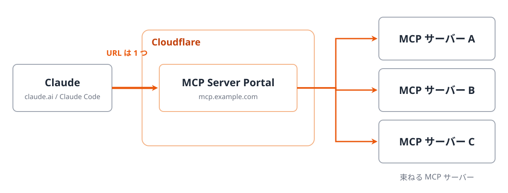
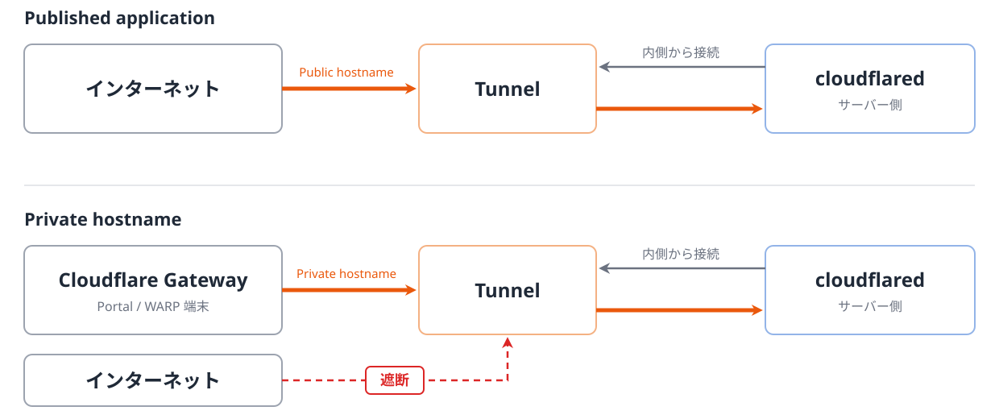
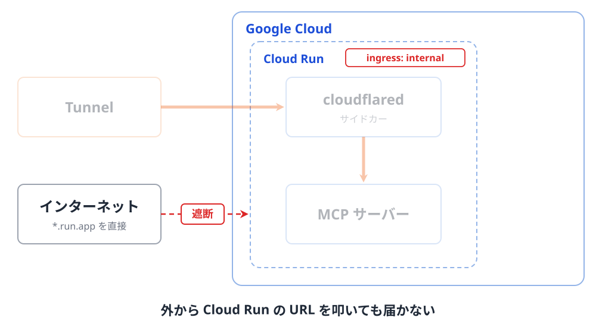
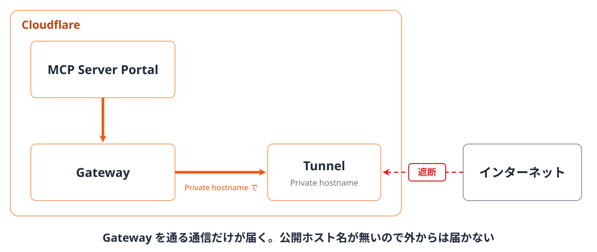
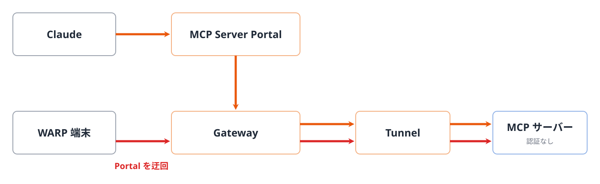
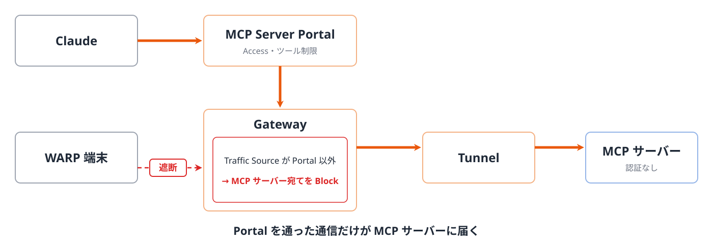

<!-- _class: lead -->

# Cloudflare MCP Server Portal × Tunnel で社内 MCP 基盤を作った話

2026-11-11 Tamachi.sre#7

---

<!-- _class: profile -->

## 自己紹介

- hide
- 開発エンジニア → SRE
- 趣味: サッカー、ビリヤニ

---

## 背景

- ビジネス側のメンバーも**社内のデータを Claude から使いたい**
- 社内 API を直接使うのは難しい（URL・認証方法がバラバラ、API キー配布は危ない）
- → MCP を利用する方針に

---

## アーキテクチャの制約

- Claude アプリからの通信は、社内ではなく Anthropic の IP 範囲（`160.79.104.0/21`, `153.61.208.0/20`）から来る
- MCP サーバーへのアクセスを社内 IP で制限するのは難しい
- そこで、次の方針にした

 

> IP 制限ではなく、入口だけをインターネットに公開し、リクエストのたびに認証・認可を行う。MCP サーバー本体はインターネットから届かない場所に置く

---

<!-- _class: figure -->

## Cloudflare MCP Server Portal

複数の MCP サーバーを 1 つの URL にまとめ、Cloudflare Access（誰がアクセスできるかをポリシーで判定する機能）で守って提供する Cloudflare の機能

---

<!-- _class: figure -->

## Cloudflare Tunnel

サーバー側から Cloudflare へ外向きの通信経路（Tunnel）を張り、**グローバル IP やポート開放なし**でサービスを公開できる機能

---

<!-- _class: figure full -->

## アーキテクチャ

---

## アーキテクチャのポイント

なるべく「閉じる」

---

<!-- _class: figure -->

## 閉じる ①: Cloud Run の ingress を `internal` に

---

<!-- _class: figure -->

## 閉じる ②: Private hostname でつなぐ

Portal から Cloudflare Gateway（Cloudflare を通る通信を検査・制御する機能）を経由して、Tunnel の Private hostname につなぐ

---

<!-- _class: figure -->

## 発生した問題

WARP 端末（通信を Gateway に送るアプリを入れた社内 PC）からの通信が、Portal を迂回して MCP サーバーに届いてしまった

---

## 原因

Private hostname で保証されるのは「Gateway 経由なら届く」ことだけで、「Portal からしか届かない」わけではない

---

<!-- _class: figure -->

## 対処

Gateway の HTTP ポリシーで、Traffic Source（通信元） が Portal 以外なら MCP サーバー宛てをブロックする条件を追加

---

## まとめ

- Cloudflare MCP Server Portal を使えば、MCP 基盤を簡単に作れる
- Portal と Cloudflare Tunnel を組み合わせると、セキュアな構成にできる
- ただし、WARP など Gateway 経由の通信も直接届いてしまうので、MCP サーバー宛ての通信は Portal 経由だけに制限する

---

<!-- _class: end -->
