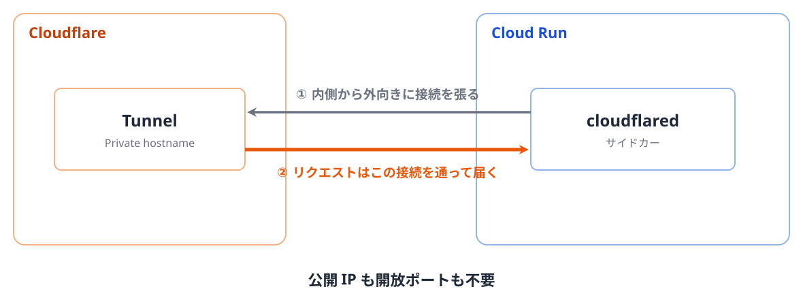

<!-- _class: lead -->

# Cloudflare MCP Server Portal × Cloudflare Tunnel × Cloud Run で社内 MCP 基盤を構築した話

2026-11-11 Tamachi.sre#7

---

<!-- _class: profile -->

## 自己紹介

- hide
- 開発エンジニア（PHP / TypeScript） -> SRE
- 趣味
    - サッカー（長年）
    - ビリヤニ（最近）

---

## 今日のゴール

- 社内 MCP 基盤を構築するときの選択肢を 1 つ知る
- その構成のポイントや注意点を知る

---

## 背景

- ビジネス側のメンバーも、**社内のデータを Claude から利用したい**という要望があった
  - 例: AI に「この商材で過去に似た施策をやったことがあるか調べて」と頼むだけで、社内の施策データベースを検索できる
- 社内 API はすでにあるが、ビジネス側のメンバーが直接使うのは現実的ではない
  - API ごとに URL や認証方式が違う
  - 利用者一人ひとりに API キーを配るのはセキュリティ的に危ない
- API の機能を MCP で提供することにした

---

## アーキテクチャの制約

- Claude からの通信は、社内ではなく Anthropic の IP 範囲（`160.79.104.0/21`, `153.61.208.0/20`）から来る
- MCP サーバーへのアクセスを社内 IP アドレスで制限するのは難しい
- IP 制限ではなく、**入口だけをインターネットに公開し、リクエストのたびに認証・認可を行う**。MCP サーバー本体はインターネットから届かない場所に置く

---

<!-- _class: figure full -->

## アーキテクチャ

---

<!-- _class: figure -->

## Cloudflare MCP Server Portal

- 複数の MCP サーバーを 1 つの URL にまとめて提供する Cloudflare の機能

---

<!-- _class: figure -->

## Cloudflare Tunnel

- サーバー側から Cloudflare へ暗号化された通信経路（Tunnel）を張り、**グローバル IP やポート開放なし**でサービスを届けられる仕組み

---

<!-- _class: figure full -->

## アーキテクチャ（再掲）

---

<!-- _class: lead -->

# なるべく「閉じる」

アーキテクチャのポイント

---

<!-- _class: figure -->

## 閉じる ①: Cloud Run の ingress を `internal` に

---

<!-- _class: figure -->

## 閉じる ②: Cloudflare Tunnel で入口を作らない

---

<!-- _class: figure -->

## 閉じる ③: Private hostname でつなぐ

- Portal は Cloudflare Gateway を経由して Tunnel の Private hostname に届く（2026 年 9 月に追加された機能。[Private MCP server support for MCP server portals](https://developers.cloudflare.com/changelog/post/2026-09-22-private-mcp-servers/)）

---

<!-- _class: figure -->

## ぶつかった壁

- WARP 端末（通信を Gateway に送るアプリを入れた社内 PC）から Portal を迂回して MCP サーバーに届いてしまった

---

<!-- _class: figure -->

## 原因と対処

- 原因: Private hostname は「Gateway 経由なら届く」であって「Portal からしか届かない」ではなかった
- 対処: Gateway の HTTP ポリシーで、Traffic Source（通信の入口）が Portal 以外なら MCP サーバー宛てを Block

---

## まとめ

- Cloudflare MCP Server Portal を使えば、MCP 基盤を簡単に作れる
- Portal と Cloudflare Tunnel を組み合わせると、セキュアな構成にできる
- ただし MCP サーバー宛ての通信を Portal 経由だけに制限しないと、WARP など Gateway を経由する通信から MCP サーバーに直接届いてしまうので注意

---

<!-- _class: end -->
