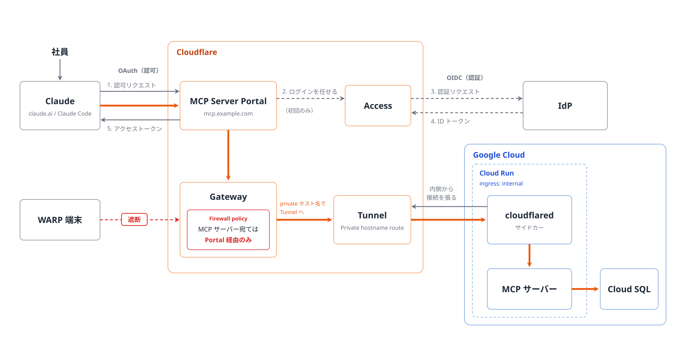

# Cloudflare MCP Server Portal × Tunnel × Cloud Run で社内 MCP 基盤を構築した話

2026-11-11 Tamachi.sre#7

---

## 自己紹介

- h6o
    - @newbee1939
- 開発エンジニア -> SRE
- 趣味
    - サッカー
    - ビリヤニ

---

## 今日のゴール

- 社内 MCP 基盤を構築するときの選択肢を 1 つ知る
- その構成での注意点を知る

---

## 背景

- ビジネス側のメンバー（非エンジニア）も、社内のデータを Claude から利用したいという要望があった
  - 例: 「この商材で過去に似た施策をやったことがあるか調べて」と頼むだけで、社内の施策データベースを検索できる
- 社内 API はすでにあるが、ビジネス側のメンバーが直接使うのは現実的ではない
  - API ごとに URL や認証方式が違う
  - 利用者一人ひとりに API キーを配るのはセキュリティ的に危ない
- そこで、API の機能を MCP で提供することにした

---

## アーキテクチャの制約

- Claude アプリの場合、通信は社内に限定されないIP範囲（`160.79.104.0/21`, `153.61.208.0/20`） から来る
- MCPへのアクセスを社内 IP アドレスで制限するのは難しい
- そこで IP 制限ではなく、次の方針を取った

> 入口（MCP Portal）だけをインターネットに公開し、リクエストのたびに認証・認可を行う。MCP サーバー本体はインターネットから届かない場所に置く

> Zero Trust の考え方

---

## アーキテクチャ

ポイントを話す前に、前提となる知識を説明します

---

## Cloudflare MCP Server Portal とは

- 複数の MCP サーバーを 1 つの URL にまとめ、Cloudflare Access の認証・認可をかけて提供する Cloudflare Zero Trust の機能
- 今回の構成では
  - 社内 MCP の唯一の入口
  - Claude に対して OAuth の窓口になる
  - 見せるMCPサーバーを Access ポリシーで、見せるツールを Portal のツール設定で絞って中継する

---

## Cloudflare Tunnel とは

- サーバーの側で動く cloudflared（Tunnel のクライアント）が Cloudflare に外向きの接続を張り、その接続を通してサービスを公開する仕組み。公開 IP も、外から受け付けるポートも不要
- 今回の構成では
  - Cloud Run の内側から Cloudflare に向けて張る通り道
  - Cloud Run 側に、外から入る口を開けずに済む

---

## アーキテクチャのポイント

- なるべく「閉じる」
- 口は最小限にする

---

## アーキテクチャのポイント（詳細）

- Cloud Run の ingress は `internal`
- 認証・認可は Cloudflare に任せる
  - MCP サーバーの実装をシンプルに保てる
- Cloudflare Tunnel で、外から入ってくる通信を完全に遮断
- Private hostname route で、内部からの通信だけを許可
  - Portal は Gateway を経由して Tunnel の private ホスト名に届く（2026 年 9 月に追加された機能。[変更履歴](https://developers.cloudflare.com/changelog/post/2026-09-22-private-mcp-servers/)）

---

## ぶつかった壁と解決策

- WARP 端末から Portal を迂回して MCP サーバーに届いてしまった
  - Gateway の Traffic Source で、Portal から来た通信だけを通すようにした
    - 特定の MCP サーバーへのアクセスを、Portal 経由のものだけに制限できる
- 同じ MCP サーバーでも、人によって使えるツールを変えたい
  - 論理 MCP で対応
    - 同じサーバーを Portal に複数登録し、それぞれで許可するユーザーとツールを分ける

---

## まとめ

- Cloudflare MCP Server Portal を使えば、MCP 基盤を簡単に作れる
- Portal と Cloudflare Tunnel を組み合わせると、セキュアな構成にできる
- ただし Gateway へのアクセスを Portal だけに制限しないと、WARP など Gateway を経由する通信から MCP サーバーに直接届いてしまうので注意

---

社内 MCP 基盤を構築するときの選択肢を 1 つとなれば幸いです
